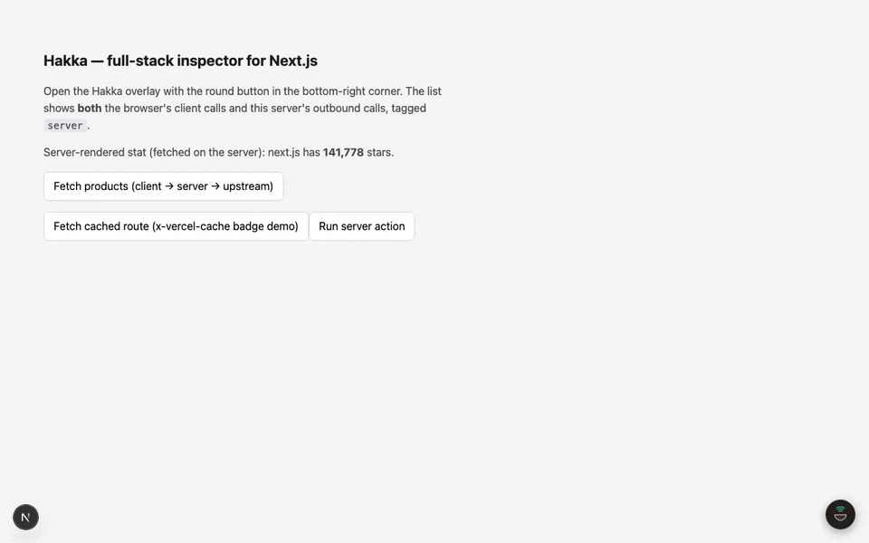
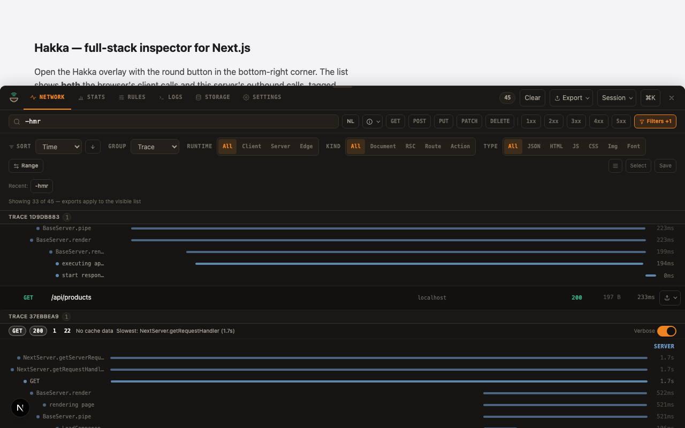

# Hakka

[](https://www.npmjs.com/package/hakka-react-native) [](https://www.npmjs.com/package/hakka-browser) [](./LICENSE) [](https://hakka.noodleapps.com)

Local-first network inspection for React Native, the web, Next.js, Android, and iOS. Find a failing request, inspect its body, and share a reproducible case with your team or coding agent.

SDK capture runs inside your app without a proxy or CA certificate. Hakka for macOS also offers an optional local proxy. Captured traffic stays local by default.



**Follow a request across Next.js.** Connect the client fetch, server route, and upstream call in one trace waterfall. The setup uses `instrumentation.ts`, `instrumentation-client.ts`, and Next.js OpenTelemetry spans.



The MCP server lets coding agents search traffic, inspect failures, apply supported controls, and export a reproduction. **Copy as agent context** also creates a bounded evidence bundle from a request.

JavaScript integrations share [`hakka-core`](./packages/hakka-core). Native SDKs own their capture and storage while using the same record contract. Each platform provides its own inspector. Performance measurements and their limits live with the [runnable examples](./examples/README.md).

## Packages

Seven npm packages, plus native SDKs for Android and iOS. The first public release is `0.2.0`. The Swift Package is live at the `v0.2.0` tag. The npm packages and Android Maven artifacts are not published yet, so the npm badges above will not resolve until they are; check [GitHub Releases](https://github.com/ansumanshah/hakka/releases) for what has shipped.

### Engine

| Package                               | What it is                                                                                                                                                                                                                                        |
| ------------------------------------- | ------------------------------------------------------------------------------------------------------------------------------------------------------------------------------------------------------------------------------------------------- |
| [`hakka-core`](./packages/hakka-core) | The platform-neutral capture engine — interceptors, ring buffer, mock/throttle engines, HAR + OpenTelemetry export, record contract. One dep (`fflate`). Also ships `hakka-core/test` — framework-agnostic helpers to assert on captured traffic. |

### Framework SDKs

| Package                                               | What it is                                                                                                                                                                                                                                                                                                                                                           | Status                                                |
| ----------------------------------------------------- | -------------------------------------------------------------------------------------------------------------------------------------------------------------------------------------------------------------------------------------------------------------------------------------------------------------------------------------------------------------------- | ----------------------------------------------------- |
| [`hakka-react-native`](./packages/hakka-react-native) | React Native SDK: native-only iOS/Android capture, with the native iOS/Android inspector opened through the TypeScript API.                                                                                                                                                                                                                                          |      |
| [`hakka-browser`](./packages/hakka-browser)           | Drop-in browser overlay (Solid, Shadow DOM, Web Worker store). Also ships `hakka-browser/vite`, `/webpack`, `/rspack` (dev-time auto-inject plugins), `/elements/*` (six standalone inspector pieces as framework-agnostic custom elements — request list, detail, waterfall, filter bar, stats, JSON tree), and `/react` (thin React wrappers over those elements). |  |
| [`hakka-node`](./packages/hakka-node)                 | Framework-agnostic Node server capture (Express, Fastify, Hono, raw `http`) with client↔server trace correlation. Also ships `hakka-node/next` (+ `/next/server`, `/next/client`) — zero-config full-stack Next.js capture, server + client traffic in one UI.                                                                                                       |  |

Beta: React Native uses native capture on iOS and Android. The npm package is not published yet.

### Native SDKs

| SDK                                                            | What it is                                                                                                | Status                                              |
| -------------------------------------------------------------- | --------------------------------------------------------------------------------------------------------- | --------------------------------------------------- |
| [`android/`](./android) (Kotlin, Maven `com.noodleapps.hakka`) | OkHttp interceptor, optional native inspector surface, FPS/memory/CPU collectors, noop release artifacts. |  |
| [`ios/`](./ios) (Swift Package)                                | URLProtocol capture, optional SwiftUI inspector, performance collectors, noop release targets.            |  |

Alpha: the Swift Package is available at `v0.2.0`. Android Maven publication is pending, so build the Android SDK from source until it lands. The `v0.1.0` source tag predates the Swift Package manifest and cannot be used as a dependency.

### Tooling & Embedding

| Package                                       | What it is                                                                                                                                                                                                                                                            |
| --------------------------------------------- | --------------------------------------------------------------------------------------------------------------------------------------------------------------------------------------------------------------------------------------------------------------------- |
| [`hakka-bridge`](./packages/hakka-bridge)     | WebSocket hub that relays captured requests between the web/Next/Node/RN/MCP peers.                                                                                                                                                                                   |
| [`hakka-rozenite`](./packages/hakka-rozenite) | **EXPERIMENTAL.** Hakka as a React Native DevTools panel via Rozenite, built on `hakka-browser`'s `/elements` and `/react` subpaths.                                                                                                                                  |
| [`hakka-cli`](./packages/hakka-cli)           | `npx hakka-cli init` — framework-aware setup. Also `hakka diagnose` and `hakka assert` for saved captures, and `hakka mcp` (+ `hakka-cli/mcp` subpath) / `hakka cdp` (+ `hakka-cli/cdp` subpath) — the MCP server for AI agents and Chrome DevTools Protocol capture. |

## Highlights

- **Framework setup:** `npx hakka-cli init` detects the framework and writes its integration.
- **Native mobile capture:** Android uses OkHttp; iOS uses URLProtocol. React Native supports native capture only.
- **Traffic controls:** [breakpoints](https://hakka.noodleapps.com/features/breakpoints), [mocking](https://hakka.noodleapps.com/features/mocking), redirects, and throttling, with platform-specific capabilities documented.
- **Agent access:** [MCP tools](https://hakka.noodleapps.com/mcp/overview) for inspection and supported runtime controls.
- **Portable evidence:** HAR, Postman, cURL, OpenTelemetry exports, and `.hakka-repro` bundles.
- **Optional native modules:** performance collectors, inspector UI, and no-op artifacts for release configurations.

## Install

Full guide: [hakka.noodleapps.com/getting-started/install](https://hakka.noodleapps.com/getting-started/install). Or run `npx hakka-cli init` to detect your framework and wire it up.

Working with a coding agent? Use the [setup guide](https://hakka.noodleapps.com/getting-started/overview) or install the reusable skill with `npx skills add ansumanshah/hakka@hakka-setup`.

### React Native

```bash
npm install hakka-react-native
cd ios && pod install
```

```tsx
import { Hakka } from 'hakka-react-native'

Hakka.start()
```

Open the native inspector from a debug menu, shake gesture, or another app action:

```tsx
const didOpen = await Hakka.show({ as: 'bubble' }) // 'bubble' | 'sheet' | 'fullscreen'
// Hakka.hide() dismisses the native surface.
```

`Hakka.show()` resolves to `true` after native presentation and `false` when native UI is not
available. React Native uses native capture only; call `Hakka.start()` before showing the inspector. See the [React Native guide](https://hakka.noodleapps.com/react-native/package/) for hooks, optional monitors, and WebView support.

### Expo (development build only — Expo Go is not supported)

```bash
npx expo install hakka-react-native expo-dev-client
```

```json
{ "expo": { "plugins": ["hakka-react-native"] } }
```

```bash
npx expo prebuild --clean
```

### Web

```bash
npm install hakka-browser
```

```ts
if (import.meta.env.DEV) {
  const { start } = await import('hakka-browser')
  start()
}
```

Or via Vite with zero app code:

```ts
// vite.config.ts
import hakka from 'hakka-browser/vite'

export default { plugins: [hakka()] }
```

### Next.js (full-stack)

```bash
npm install hakka-node hakka-browser
```

```ts
// instrumentation.ts
export { register } from 'hakka-node/next'
```

```ts
// instrumentation-client.ts
import 'hakka-node/next/client'
```

Server and client requests show up in one overlay. Requires Next 15.3+.

### Android

```kotlin
dependencies {
    debugImplementation("com.noodleapps.hakka:hakka-network:0.2.0")
    debugImplementation("com.noodleapps.hakka:hakka-ui:0.2.0")
    releaseImplementation("com.noodleapps.hakka:hakka-network-noop:0.2.0")

    // optional performance collectors
    debugImplementation("com.noodleapps.hakka:hakka-performance:0.2.0")
    releaseImplementation("com.noodleapps.hakka:hakka-performance-noop:0.2.0")
}
```

One line wires capture plus the inspector (auto-launcher notification, shake-to-open) and native performance monitoring:

```kotlin
import com.noodleapps.hakka.ui.installHakka

val client = OkHttpClient.Builder()
    .installHakka(context, perfMonitoring = true)
    .build()
```

Headless (capture only, no UI): `.addInterceptor(HakkaInterceptor())`.

### iOS (Swift Package Manager)

In Xcode, choose File > Add Package Dependencies, enter `https://github.com/ansumanshah/hakka`, and set the rule to Up to Next Major Version from `0.2.0`. Or add it to `Package.swift`:

```swift
.package(url: "https://github.com/ansumanshah/hakka", from: "0.2.0")
```

Select the products you need: `HakkaNetwork`, `HakkaNetworkNoop`, `HakkaPerformance`, `HakkaPerformanceNoop`, `HakkaUI`. Link `HakkaNetworkNoop` in release configurations.

```swift
import HakkaNetwork
import HakkaUI

HakkaInterceptor.shared.start() // capture
BubbleWindow.shared.show()      // optional floating inspector button (HakkaUI)
```

Use `HakkaInterceptor.shared`: the inspector reads from it, so a separately constructed `HakkaInterceptor()` captures traffic the UI never shows.

## Examples

Seven runnable examples, one per integration surface. Each has its own README with a guided
walkthrough.

| Example                                                            | Surface                 | Run it                                           |
| ------------------------------------------------------------------ | ----------------------- | ------------------------------------------------ |
| [`examples/next-fullstack`](./examples/next-fullstack)             | Next.js server + client | `just demo-claude-code` (or `npm run dev` there) |
| [`examples/claude-code`](./examples/claude-code)                   | MCP / AI agents         | `claude mcp add hakka -- npx -y hakka-cli mcp`   |
| [`examples/browser-demo`](./examples/browser-demo)                 | Plain web               | `just demo-browser`                              |
| [`examples/react-native-example`](./examples/react-native-example) | React Native            | `just dev-ios` / `just dev-android`              |
| [`ios/Example`](./ios/Example)                                     | iOS (Swift)             | `just build-ios-demo`, then run in Xcode         |
| [`android/example`](./android/example)                             | Android (Kotlin)        | `cd android && ./gradlew :example:installDebug`  |
| [`examples/ci-gate`](./examples/ci-gate)                           | Node CI gate            | `bun test examples/ci-gate/ciGate.test.ts`       |

The Next.js one is the most complete: server and client capture in one inspector, an eight-step
guided checklist, desktop-mode bridging, and production cohort capture.

## Docs

[hakka.noodleapps.com](https://hakka.noodleapps.com)

- [Overview](https://hakka.noodleapps.com/getting-started/overview)
- [hakka-core engine](https://hakka.noodleapps.com/core/overview)
- [Architecture](https://hakka.noodleapps.com/contributing/architecture)
- [Contributing](./CONTRIBUTING.md)
- [Editable launch animation](./media/launch/README.md)

## License

MIT. See [LICENSE](./LICENSE). That covers everything in this repository, the macOS app included:
read it, fork it, build it, use your own build however you like.

The official signed and notarized macOS builds are a paid product, on the honour system, with no
DRM. The `hakka-*` SDKs are free forever and are not part of that. See
[apps/hakka/COMMERCIAL.md](./apps/hakka/COMMERCIAL.md) for exactly where the line sits.
